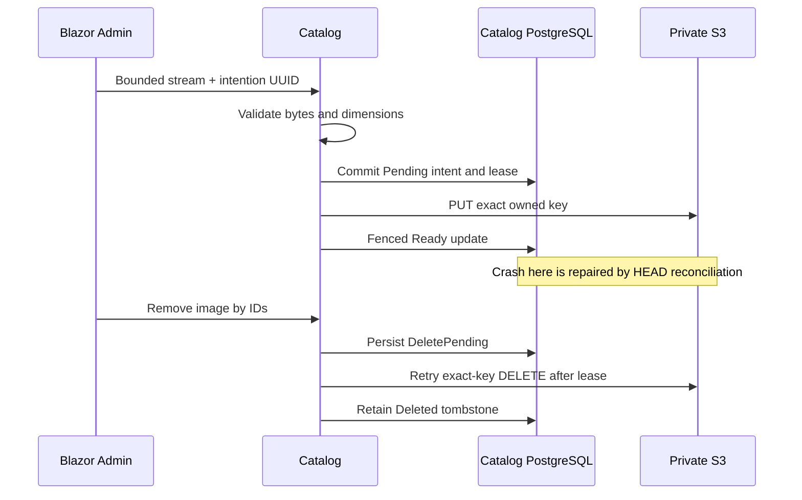
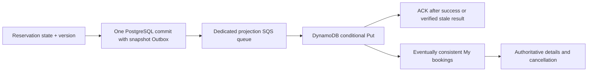

# Learn from the implemented extensions

## Object storage and cross-system recovery

`src/Catalog.Api/Images/ImageStorage.cs` is the replaceable object boundary. S3 stores bytes keyed by a server-generated identifier; PostgreSQL `TourImage` owns lifecycle metadata. Expiring URLs are delegated read capabilities, so rows store keys instead of URLs. Authorization precedes capability generation. A filename/MIME header is user input; `ValidatedImage.cs` checks actual contents, byte/pixel bounds and decoder results.

`TourImages.cs` holds no SQL transaction during S3 calls. The lease/status fence prevents a late Ready update from undoing deletion. Recovery knows the exact key/hash/size from a committed intent; it never infers ownership by scanning a bucket. Exercise: explain the difference between idempotent effects and exactly-once delivery, then run the metadata-crash and deletion-race tests in `ImageExtensionTests.cs`. Timeouts can be unknown outcomes, so cleanup must allow reconciliation rather than assume no object was written.

## DynamoDB access patterns and conditional writes

`src/Reservations.Api/Bookings/BookingStore.cs` defines the table around two queries: an owner's point lookup and newest-first owner pages. Main keys include owner and reservation; a GSI sorts by immutable creation timestamp plus UUID. There is no Scan. Main reads can be consistent, while GSI updates are eventually consistent. `BookingCursor` encrypts/authenticates the last key with a dedicated key and binds identity, page size and expiry.

Atomic conditional Put accepts only a higher version. Comparing versions in C# then writing would race two consumers. Equal/older conditions are verified safe no-ops. Exercise: deliver version3, then1, then3 again and explain why the accepted amount/status cannot regress; run `DynamoConditionalUpdatesPaginationAndForeignOwnerLookupsRemainSafe`.

## CQRS, transactions and asynchronous boundaries

The same Reservations Outbox has two bounded lease drains: the business drain excludes booking projections, and `BookingOutboxWorker` claims only them. This isolates queue publication failure as well as DynamoDB failure, without making reservation commits depend on either read-model component.

`ReservationsDb.SaveChangesAsync` adds `BookingSnapshotChanged` to the owned Outbox before the authoritative PostgreSQL commit. The event is self-contained. Quote and reservation tour-name fields retain the accepted meaning; Catalog rename is unrelated to that immutable snapshot. Legacy data explicitly lacks that fact.

`BookingProjectionConsumer` has no PostgreSQL Inbox gate before Put. Otherwise a crash after Inbox commit but before DynamoDB success could suppress every retry. `MessagePump` ACKs only after the external durable effect. A crash after Put before ACK duplicates delivery; the conditional write handles it. No PostgreSQL/DynamoDB transaction is claimed.

`BookingRebuilder` emits bounded keyset batches through the same Outbox path, with unchanged versions. A stale rebuild cannot overwrite a newer event. Exercise: explain why a fresh timestamp does not prove the booking is Confirmed, why DynamoDB outage must not prevent refunds, and why deleting a table/resetting Inbox is a poor replay strategy. Run the outage, crash-before-ACK and delayed-rebuild tests in `BookingExtensionTests.cs`.

## Roadmap topics actually used

Records represent integration/read contracts; mutable classes are service-owned EF entities. Nullable results distinguish missing objects/bookings. Async cancellation reaches streams, SQL, SDK calls and worker loops. DI shares SDK clients, limits and cursor services while workers create async scopes for work; they never retain a scoped DbContext. Options validate private configuration. Endpoint policies enforce Admin/owner checks independently of Blazor controls. EF transactions and DynamoDB conditions solve different consistency problems; no artificial repository/event-sourcing/dispatcher pattern was introduced.

Local S3Proxy/DynamoDB are emulators, not AWS verification. Observe actual IAM, GSI latency, task sizing, price and persistence during a separately authorized LAB-009. No learning topic is marked mastered merely by these tests.
